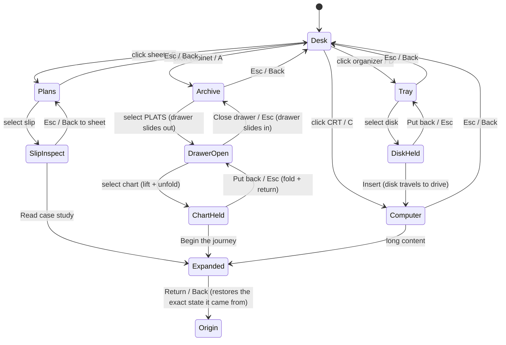

# 05B plan: Drafting Plans and Flat-File Archive stations (for review; nothing implemented)

Base: `1ded8c4` (05A.1). This document only plans; no code changes, push, deploy, backend or HeyHab work.

## Ground truth this plan is built on (verified in the repo)
- **Registry GIS/CAD projects:** `parcel-engine` (`GIS_PROJECTS`, tags "python · cogo · dxf / geojson") and `groundrules` (`PROJECTS`, tags "parcel data · zoning · GIS · public records"). These are the only two with GIS/CAD substance. No other project is presented as GIS work.
- **Drafting plans in the scene:** the taped survey sheet on the desk, right of the computer (1150×800, with lots, bearings, contours, north arrow, REV 03), plus three rolled plans and the framed plat on the wall. The drawing is **decorative drafting**; its lots are not data from either project. The plan must not imply otherwise.
- **Flat-file cabinet:** six rows by two columns of drawer **fronts** with brass pulls and label cards (PLATS, SURVEY, CAD SHEETS, RECORDS, INDEX, DRAFTS). They are flat boxes today: no drawer body, nothing inside, and nothing can open.
- **Project World:** the existing component; `WorldMap` is a React SVG component with an `interactive` prop. It can be rendered unchanged, non-interactive, on a physical chart in the room (as the CRT already renders React through CSS3D). No second copy of the map art or data is needed.
- **Existing machinery to reuse:** the station/URL model (`src/lib/stations.js`), the controller's epoch-cancelled actions, `busy` gating, the remembered desk viewpoint, pick-up-to-camera (`holdPose`), CSS3D DOM on surfaces, the expanded interface with return-to-origin, the HI-FI/LO-FI switch.

## 1. Interaction architecture

### Two new stations
| Station | URL | Camera | Physical objects | What the visitor does | Content and surface |
|---|---|---|---|---|---|
| **Plans** | `/#plans` | Moves over the desk's right side and tilts down onto the survey sheet (top-three-quarter view; the rolled plans and the edge of the computer stay in frame for continuity). | The survey sheet with **two pinned project slips** clipped to it (paper slips held by the existing drafting tape; real objects, not overlays). | Hover or tap a slip (label shows "G-01 · Parcel Engine"); select it to **inspect**. | The slip itself carries registry content printed on paper (CSS3D on the slip plane): title, `titleEm`, `desc`, `status`, case ID. |
| Plans, slip inspected | `/#plans/<slug>` | Dollies down onto that slip so it fills about 60% of the frame. | The slip | "Read case study" goes to the expanded interface; "Repository" for Parcel Engine (registry `repo`) opens a new tab; Esc or "Back to the sheet" returns. | The same slip, now readable. |
| **Archive** | `/#archive` | Lowers and turns to face the flat-file cabinet from the visitor's side of the desk (the desk edge is visible above, so the visitor knows where they are). | The drawer fronts; **one drawer becomes real**: PLATS (top row, left), with a body and a pull that slides. | Hover a drawer (label: "PLATS · chart drawer"); select it. Drawers with nothing inside say so on hover ("SURVEY · empty") and do not open. No fake contents. | The drawer's own label card. |
| Archive, drawer open | `/#archive/plats` | Holds, slightly higher, looking down into the open drawer. | The open PLATS drawer, holding a folded chart titled with Project World's own heading ("Project World · Chart № 01 · The systems I build"). | Select the chart to **lift** it (same pick-up path as disks). | The chart cover. |
| Archive, chart held | `/#archive/chart` | Unchanged; the chart rises to the camera and unfolds. | The chart, unfolded in front of the camera, showing the **real `WorldMap` component** non-interactive on its surface. | "Begin the journey" expands into the existing Project World (unchanged, with its scroll journey and the Lookup after it). "Put it back" returns the chart to the drawer; closing the drawer is separate. | The real map on paper; the full journey in the expanded interface. |

**Optional (decide below): INDEX drawer.** The drawer opens to index cards, one per registry disk project (case ID, title, `titleEm`), giving every case study a second physical path. Selecting a card goes to its case study.

### Discovery without relying on the bottom bar
1. **The room shows them:** the desk view already frames the survey sheet and the cabinet. Desk look-around's downward limit increases slightly (from -0.12 to about -0.2 rad) so a visitor who looks down sees the drawer fronts clearly.
2. **Hover labels and affordance:** the sheet ("Survey sheet · two project notes pinned"), each slip, the cabinet and each drawer get labels; the PLATS pull catches a faint warm rim highlight on hover only. No pulsing or idle animation.
3. **Cross-references inside the world:**
   - The CRT's WORLD.MAP entry gains "Filed in the PLATS drawer" with two choices: *Open the drawer* (camera to the archive, drawer opens) or *Expanded view*.
   - The Parcel Engine and GroundRules floppy READMEs mention "Notes pinned to the survey sheet" with a link that moves the camera to the slip.
4. **First-visit line** in the desk hint ("Look down: the plans and the archive are part of the desk"), shown once per session, dismissible.
5. **Secondary aids, still present:** the station switcher (5 stations), shortcuts P (plans) and A (archive), ←/→ cycling, Esc stepping back.

### Content rules
- Only registry fields and existing components. Slip text and index cards come from `projects.js`; the chart shows `WorldMap`; detailed reading uses the existing case-study pages and Project World. No new copy about the projects.
- The survey drawing stays decorative; the slips are **pinned notes on it**, never captions claiming the drawing is the project's output.

## 2. Camera and object state diagram

**Object state invariants (reversible by construction):**
- **One object in hand at a time.** Selecting a chart while a disk is held puts the disk back first (the existing `returnOthers`). The loaded drive disk is unaffected.
- **The drawer has three states:** closed, opening/closing, open. The chart has four: in drawer, lifting, held, returning. Each move tweens from the current pose, so interruptions reverse cleanly (epoch cancellation). Exact home poses are stored, as for disks.
- **Leaving the archive station closes the drawer**, after returning the chart if it is held, so the scene is never left half-open. Returning from the expanded interface restores ChartHeld exactly.
- **URLs are written only in settled states**, and Back/Forward drive the same actions (05A pattern).
- **The desk viewpoint is remembered** across all new stations.

**Occlusion, click targets, collisions:**
- **Archive pose:** a fixed camera in front of the cabinet (outside its bounding box, above the floor and below the desk's front edge). The drawer slides at most 380 units toward a camera about 900 units away, with no intersection. Only the top two rows are targeted, so the desk overhang does not hide them.
- **Plans pose:** above the sheet, clear of the lamp arm and the rolled plans, which sit behind the sheet. A clearance check runs against the lamp, the rolls and the CRT, as for disks.
- **Hit areas:** slips are at least 140×90 units, which is at least 44 CSS px on a 390 px phone at the plans pose (to be measured). Drawer fronts take the whole front as the target. Picking is raycast against the target objects only, so decorative props never steal a click.
- **The chart held to the camera** reuses `holdPose`, sized so the map is readable, with a distance check against the cabinet and desk.

## 3. Proposed user journey (acceptance demonstration)
1. At the desk, look around and look down; the plans and the cabinet are visible, and hovering names them.
2. Select the survey sheet. The camera moves over it (`/#plans`) and two pinned slips are visible.
3. Select the Parcel Engine slip. The camera closes in (`/#plans/parcel-engine`) and the registry text is readable on the paper. Open "Read case study", return, and land back on the inspected slip.
4. Esc back to the sheet, Esc back to the desk at the remembered viewpoint.
5. Select the cabinet (`/#archive`); hovering SURVEY says "empty", hovering PLATS says "chart drawer".
6. Select PLATS. The drawer physically slides out (`/#archive/plats`) and the folded chart is visible inside.
7. Select the chart. It lifts and unfolds in front of the camera (`/#archive/chart`), showing the real Project World map.
8. "Begin the journey" opens the existing Project World full screen. Return lands on the held, unfolded chart.
9. Put it back, close the drawer, back to the desk: the drawer is closed and the chart is home, exactly.
10. Repeat by keyboard only (P, A, Tab/Enter, Esc) and by simulated touch at 390×844. Exercise direct links to each new URL and Back/Forward through the whole sequence.

## 4. Acceptance criteria
- **Physical:** the drawer and the chart are real scene objects that move; the slips are physical paper on the sheet. No overlay replaces the room for any in-world step.
- **Content:** every displayed fact traces to `projects.js` or the existing `WorldMap` / Project World components (checked by extending `verify-claims.cjs`). Nothing on the drawing is presented as project output.
- **Two physical paths per GIS project** (disk and slip). If the INDEX drawer is approved, **two physical paths for every disk project** (disk and index card).
- **Continuity:** every station change is a single tweened camera move. No cuts except under reduced motion. The desk viewpoint is restored after any excursion.
- **Reversibility:**
  - After any sequence, including interrupted ones, putting back and closing returns the drawer, chart, slips and disks to exact home poses (four-decimal check).
  - Leaving the archive never leaves an open drawer.
- **History:** `/#plans`, `/#plans/<slug>`, `/#archive`, `/#archive/plats` and `/#archive/chart` deep-link into the correct state. Back/Forward reproduce the visit without resets, and expanded views return to their origin.
- **Access:**
  - Keyboard: P/A shortcuts, Tab order through the slips and drawer controls, Esc steps back one level, and focus follows the camera.
  - Touch: 44 px effective targets for slips and drawers, measured at 390 px.
  - LO-FI is unchanged and still lists every destination.
- **Collisions and occlusion:** bounding-box checks at each pose (camera vs cabinet, desk and lamp; held chart vs cabinet, desk and CRT) show no intersection. Raycast targets cannot be blocked by decorative props.
- **Regression:** the 05A and regression suites stay green on dev and production builds. A new 05B suite records frame sequences for mouse, keyboard and touch, like 05A.
- **Honesty of testing:** results say automated Chromium. A real iPhone/Safari pass remains a prerequisite before any production decision.

## 5. Scope and implementation outline (for after approval)
1. **Scene:**
   - Give the PLATS drawer (and INDEX, if approved) a real body and inner tray.
   - Build a folded/unfolded chart object with a CSS3D surface.
   - Add two paper slips on the sheet with CSS3D surfaces.
   - All of this reuses existing materials. No new decorative props.
2. **Controller:**
   - States `plans`, `slip`, `archive`, `drawer`, `chart`.
   - Actions `goPlans`, `inspectSlip`, `goArchive`, `openDrawer`, `closeDrawer`, `liftChart`, `returnChart`.
   - The same epoch/busy pattern, with clearance checks in tests.
3. **Stations:** extend `stations.js` (URLs and labels); the switcher becomes five chips, laid out in two rows or a scroller on phones (see decisions).
4. **React surfaces:** a `PlansSlip` from registry fields, the chart using `WorldMap` with `interactive={false}`, and index cards if approved.
5. **Tests:** `verify-05b.cjs` with recorded journeys; extend `verify-claims.cjs`; keep the suites green.
Estimated as a single iteration, with a checkpoint after the Plans station if you prefer two steps (05B.1 Plans, 05B.2 Archive).

## 6. Decisions needed
1. **INDEX drawer** with registry index cards, giving every project a second physical path: include in 05B, or defer?
2. **Station switcher on phones** with five stations: two rows of chips (taller), a horizontal scroller, or a single "Stations" sheet button?
3. **Cross-references** from the CRT (WORLD.MAP → "Open the drawer") and from the floppy READMEs to the slips: approve?
4. **Delivery:** one 05B iteration, or split into 05B.1 Plans then 05B.2 Archive?
5. **Look-down limit** at the desk from -0.12 to about -0.2 rad: approve?
